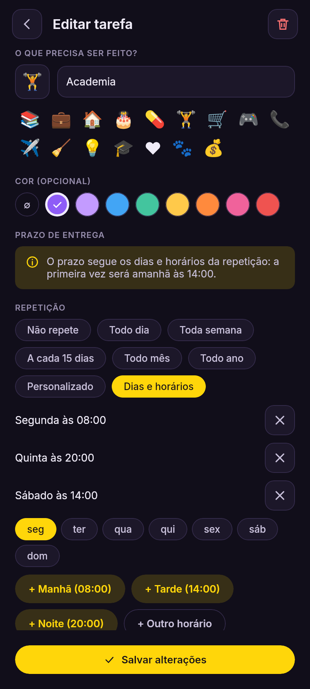
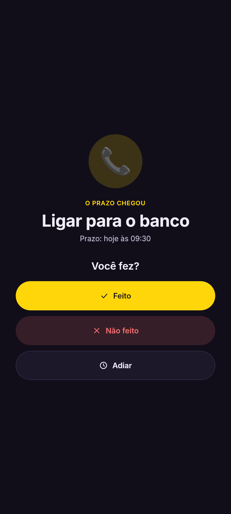
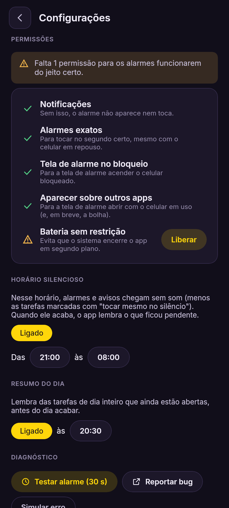

# Just in Time ⏱️

App de tarefas com prazo da **NokyLabs**: você coloca o que precisa ser feito e quando, e o app mostra o tempo passando. Quando o prazo chega, ele toca e pergunta se a tarefa foi feita.

Android primeiro; Windows e Linux depois, com o mesmo código de regras e telas (Kotlin Multiplatform + Compose).

| Lista | Editar | Alarme | Configurações |
|---|---|---|---|
|  |  |  |  |

## Status

**0.2.0-alpha.1**
- Tarefas com emoji, cor, prazo com horário exato ou de dia inteiro, e repetições: todo dia, toda semana, a cada 15 dias, todo mês, todo ano, a cada N, ou dias e horários específicos.
- A próxima tarefa aparece em destaque, com contagem regressiva.
- Responder na lista ou na tela de alarme. Histórico. Aviso quando já existe uma tarefa com o mesmo nome ou horário.
- Alarme exato com tela de alarme (no bloqueio e com o celular em uso), som que silencia em 60 s, avisos antes do prazo, horário silencioso, resumo do dia.
- Configurações com as permissões e relatório de bugs.

**Próxima etapa (0.3.0):** widget com contagem regressiva, notificação-resumo e bolha flutuante.

## Como compilar

O visual vem do [NokyLabs.UI](https://github.com/ThayTTG/NokyLabs.UI) (pasta `compose/`), trazido como *submodule*. Por isso, clone assim:
```powershell
git clone --recurse-submodules https://github.com/ThayTTG/Just-in-Time.git
```
Se você já clonou sem isso: `git submodule update --init`.

Depois é só abrir a pasta no **Android Studio** e rodar o `androidApp`. Pelo terminal:
```powershell
./gradlew :androidApp:assembleDebug   # APK em androidApp/build/outputs/apk/debug/
./gradlew :shared:desktopTest         # testes das regras
./gradlew :shared:capturar            # imagens das telas em capturas/
```
Para atualizar o kit visual: `git submodule update --remote lib/NokyLabs.UI`.

## Estrutura

```
shared/          regras, banco de dados e telas (Android + PC)
  dominio/       Tarefa, Ocorrencia, Repeticao e Tarefas (todas as regras)
  dados/         tabelas SQLDelight (.sq)
  dominio/Lembretes.kt   avisos, horário silencioso e resumo do dia
  ui/            telas em Compose com o NokyLabs.UI (lista, editor, alarme, configurações)
androidApp/      o app Android: alarmes, notificações, permissões, relatório de bugs (em breve, widget e bolha)
lib/NokyLabs.UI  kit visual (submodule)
prototipo/       o protótipo de testes (v0.0.1 a v0.0.4), guardado como referência
```

O princípio é este: **as regras não conhecem o Android.** Elas falam com um `Agendador` (no Android, o AlarmManager; no PC, um temporizador) e um `Relogio`. É isso que deixa a versão de PC barata depois, e permite testar tudo sem celular.

### Decisões
- **Hora local, como um despertador:** um prazo às 18:00 continua às 18:00 mesmo se o fuso mudar.
- **Tarefa × Ocorrência:** cada vez que uma tarefa vence, nasce uma ocorrência, e é ela que recebe a resposta. Uma tarefa que se repete toda segunda tem uma ocorrência por segunda, e o histórico sai delas.
- **Repetição pela âncora:** as próximas datas são calculadas a partir do primeiro prazo. Assim, adiar uma ocorrência não empurra as seguintes, e "todo dia 31" volta a ser 31 depois de fevereiro.
- **IDs em UUID**, para facilitar a integração futura com o PlaningThings.
- **Cor do app:** `NokyColors.JustInTime` (`#FFD60A`, amarelo-limão).

## Versões das ferramentas
Kotlin 2.0.21 · Compose Multiplatform 1.7.3 · SQLDelight 2.0.2 · kotlinx-datetime 0.6.1 · Android Gradle Plugin 8.7.3 · Gradle 8.11.1 · Android 8.0+ (minSdk 26).

---
Idealizado e aprovado por Thayna Dias · Desenvolvido com IA (Claude, da Anthropic)
